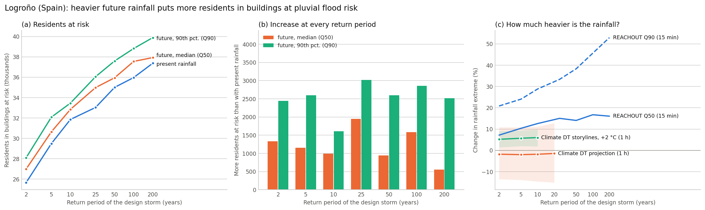

# Future rainfall and building-level pluvial flood risk in Logroño

> **Does heavier future rainfall put more residents of Logroño (Spain) in buildings at pluvial flood risk?** — one FORRT nanopublication chain, built on the [Logroño flood-adaptation scenarios analysis v0.1.0](https://doi.org/10.5281/zenodo.23298913).

**Finding:** *Heavier future design rainfall increases the number of residents of Logroño living in buildings at pluvial flood risk* — in all 42 cases examined; no building moves to a lower risk class.

The notebooks: (1) the analysis release, (2) the inputs of this finding, (3) the finding in every case, (4) the figure. The chain is listed in [`nanopubs/PUBLISHED.md`](nanopubs/PUBLISHED.md) once published.

Cite via [`CITATION.cff`](CITATION.cff) → DOI [{{ZENODO_DOI}}]({{ZENODO_DOI}}).

Climate DT: *this data is created based on data of the European Union, using the Destination Earth Platform, but has been modified by Anne Fouilloux.*
